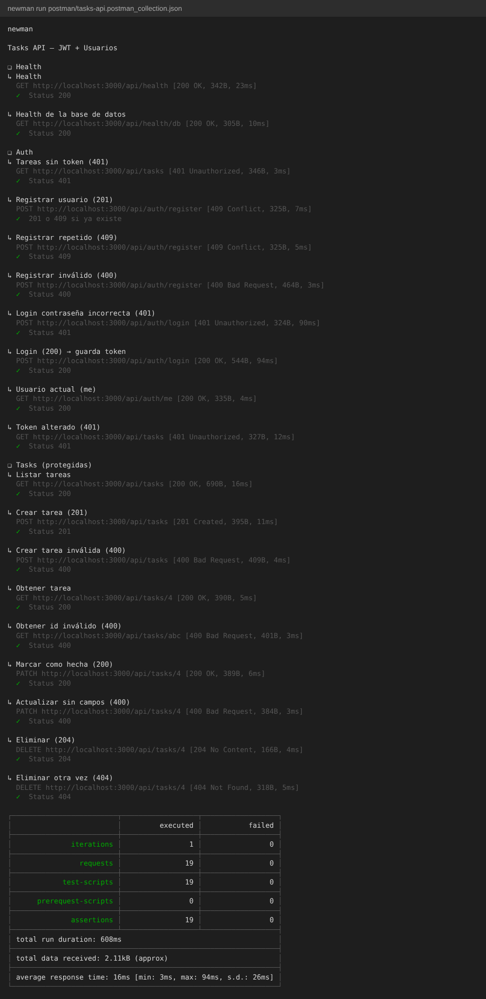
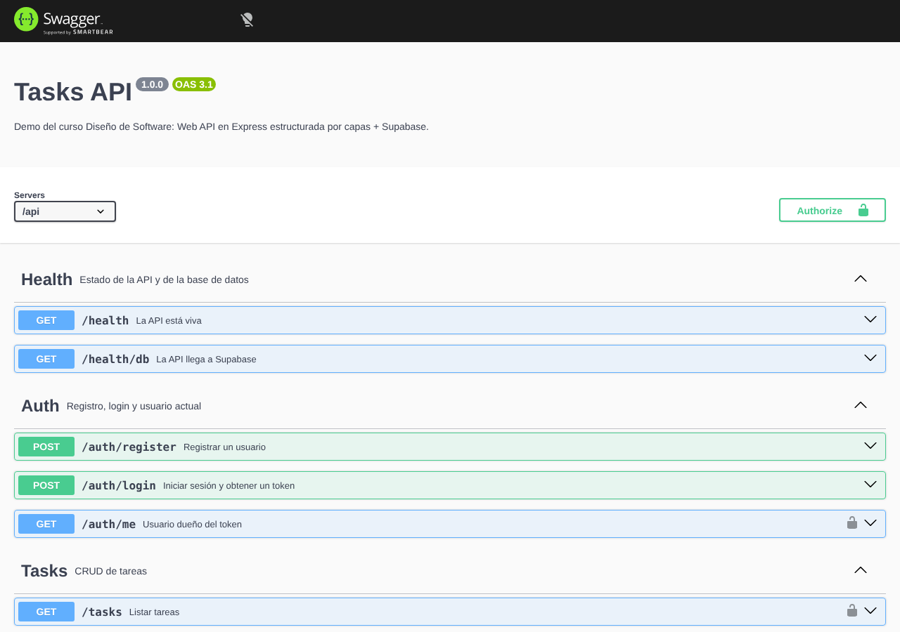
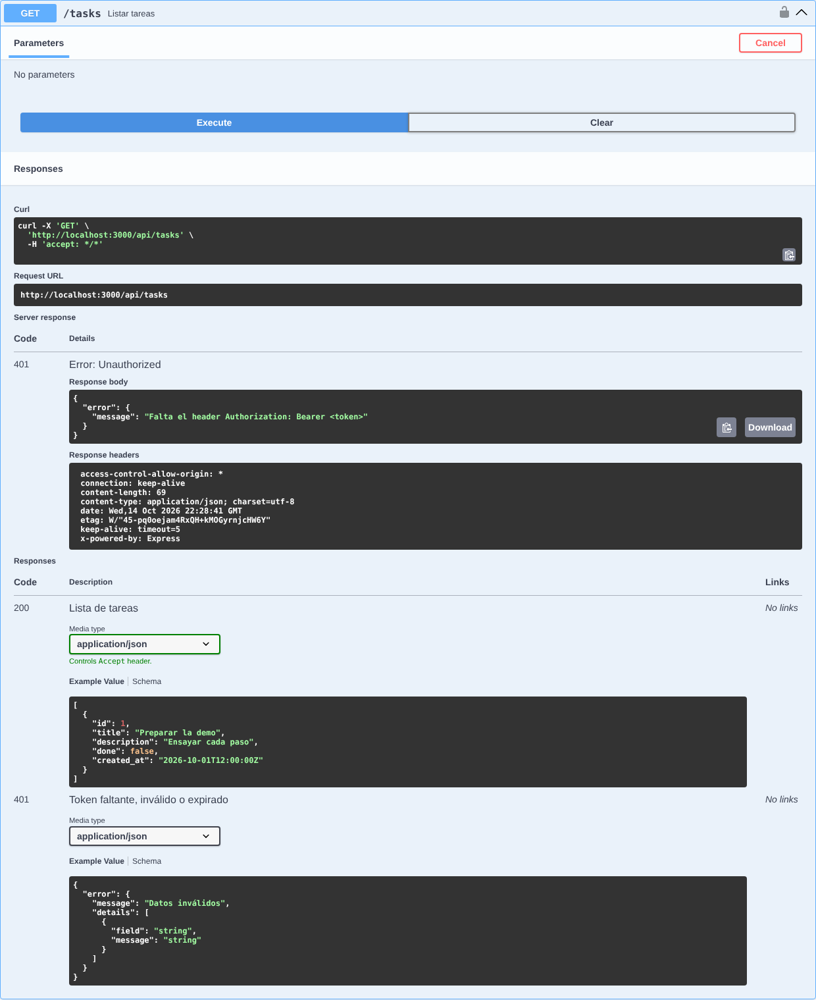
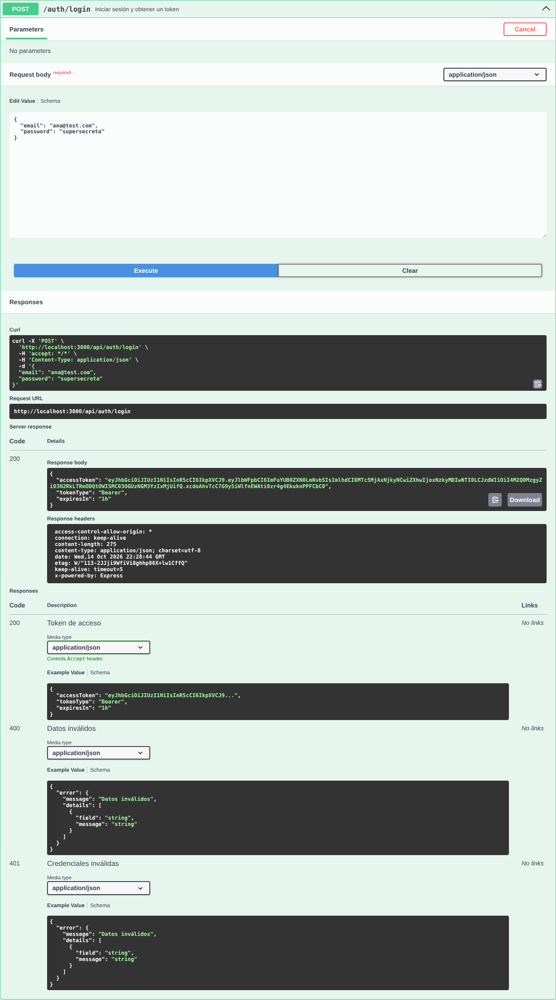
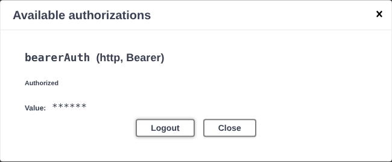
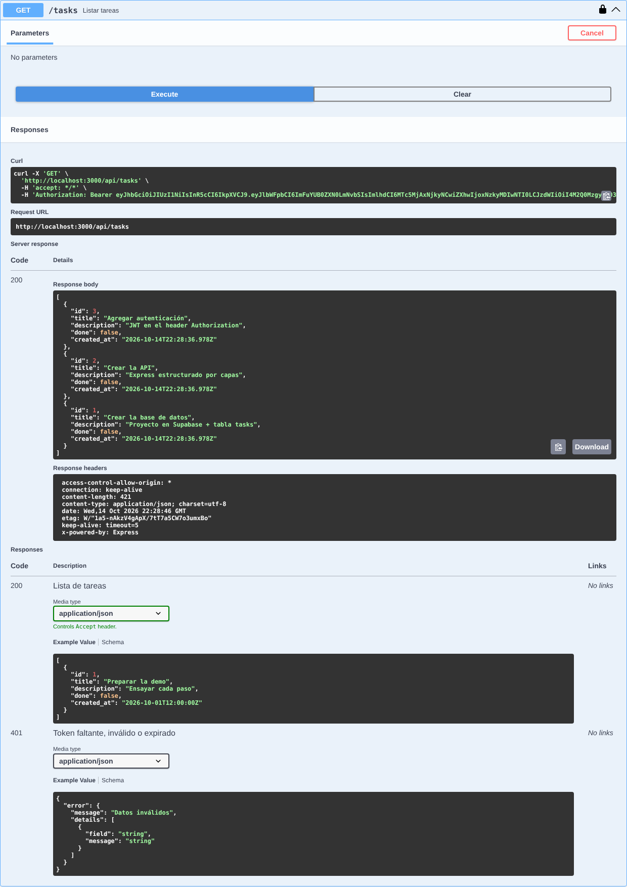

# tasks-api

Demo del curso **Diseño de Software**: una Web API en Node.js (Express 5) organizada por capas que usa **Supabase** como base de datos, documentada con Swagger (OpenAPI 3.1).

> El guion paso a paso para presentarla en clase está en [TUTORIAL.md](./TUTORIAL.md).

## Requisitos

- Node.js 20.6 o superior (usa `--env-file` y `--watch`, así que no hacen falta `dotenv` ni `nodemon`)
- Un proyecto en [Supabase](https://supabase.com)

## Puesta en marcha

1. En Supabase → **SQL Editor**, ejecutar `supabase/01_tasks.sql` y luego `supabase/02_auth.sql`.
2. Copiar `.env.example` a `.env` y completar `SUPABASE_URL`, `SUPABASE_SECRET_KEY` (Project Settings → API Keys) y `JWT_SECRET` (generarlo con `node -e "console.log(require('crypto').randomBytes(48).toString('base64url'))"`). La secret key solo se usa en el servidor: la base de datos queda cerrada y la API es la única puerta de entrada.
3. Instalar y levantar:

```bash
npm install
npm run dev
```

4. Abrir la documentación interactiva en **http://localhost:3000/api/docs** (o usar `requests.http` con la extensión REST Client).
5. **Postman:** importar `postman/tasks-api.postman_collection.json` y ejecutarla en orden con el *Runner*. El login guarda el token en la variable `{{token}}` y las rutas de tareas lo usan solas.

## Estructura

```
src/
├── server.js                 # Arranca el servidor HTTP (solo eso)
├── app.js                    # Construye la app: middlewares, rutas y manejo de errores
├── routes.js                 # Monta los módulos bajo /api
├── config/env.js             # Lee y valida variables de entorno (zod)
├── lib/supabase.js           # Cliente de Supabase
├── lib/jwt.js                # Firmar y verificar tokens (único que conoce jsonwebtoken)
├── docs/                     # Swagger: helpers, openapi.js (junta los módulos), docs.routes.js
├── middlewares/              # validate, auth (requireAuth), not-found, error-handler
├── utils/http-error.js       # Error con código HTTP
└── modules/
    ├── health/               # GET /api/health, GET /api/health/db (+ health.docs.js)
    ├── auth/                 # register, login, me (routes, controller, service, users.repository, schema, docs)
    └── tasks/
        ├── tasks.routes.js       # Rutas + composición de dependencias
        ├── tasks.controller.js   # HTTP  ->  servicio
        ├── tasks.service.js      # Reglas de negocio
        ├── tasks.repository.js   # Acceso a datos (único que conoce Supabase)
        ├── tasks.schema.js       # Schemas zod: validan la entrada y generan la doc
        └── tasks.docs.js         # Documentación OpenAPI del módulo
supabase/
├── 01_tasks.sql              # Tabla tasks + datos de ejemplo
└── 02_auth.sql               # Paso 7: tabla users (email + hash bcrypt)
```

## Endpoints

| Método | Ruta              | Descripción                         |
|--------|-------------------|-------------------------------------|
| GET    | `/api/docs`       | Swagger UI                          |
| GET    | `/api/docs/openapi.json` | Especificación OpenAPI (JSON) |
| GET    | `/api/health`     | La API está viva                    |
| GET    | `/api/health/db`  | La API llega a Supabase             |
| POST   | `/api/auth/register` | Registrar (`email`, `password`)  |
| POST   | `/api/auth/login` | Login → `{ accessToken }`           |
| GET    | `/api/auth/me`    | Usuario del token 🔒                |
| GET    | `/api/tasks`      | Listar tareas 🔒                    |
| GET    | `/api/tasks/:id`  | Obtener una tarea 🔒                |
| POST   | `/api/tasks`      | Crear (`title`, `description?`, `done?`) 🔒 |
| PATCH  | `/api/tasks/:id`  | Actualizar parcialmente 🔒          |
| DELETE | `/api/tasks/:id`  | Eliminar 🔒                         |

🔒 = requiere `Authorization: Bearer <token>`; sin él la respuesta es `401`.

Errores siempre con la forma `{ "error": { "message": "...", "details": [...] } }`.

## Pruebas

Colección de Postman: [`postman/tasks-api.postman_collection.json`](./postman/tasks-api.postman_collection.json) (19 peticiones con tests). Se ejecutó completa con **newman** (el runner de línea de comandos de Postman) y con **Swagger UI**.

### Colección ejecutada (newman): 19/19 ✅



### Flujo de autenticación en Swagger

| 1. Documentación | 2. Sin token → `401` |
|---|---|
|  |  |

| 3. Login → token | 4. Authorize | 5. Con token → `200` |
|---|---|---|
|  |  |  |
